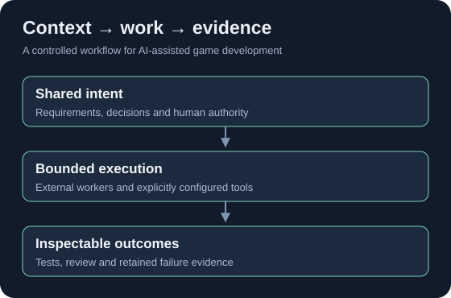

# GameFactory V2

### An experimental multi-agent framework for AI-assisted game development

GameFactory organizes game-development work around shared context, bounded tasks, verifiable outputs and explicit human decisions.

**Burak Yenice** · Applied AI studies at the **Technical University of Denmark (DTU)** · Proprietary core · Experimental preview

[Architecture](docs/architecture.md) · [Applied AI case study](docs/applied-ai-case-study.md) · [Demonstration](docs/demo.md) · [Verification](docs/verification.md)

## The problem

A useful AI-generated change can still break a game. Requirements are scattered across conversations, agents lose decisions during handoffs, and a successful command may be mistaken for a successful product. Without traceable context and evaluation, iteration becomes difficult to explain or reproduce.

## The approach

GameFactory treats AI-assisted development as a controlled workflow. A Director selects relevant context and specialist responsibilities. External workers receive bounded tasks. Source changes, tests and review remain separate steps, with human approval for material decisions.

The implemented Director is deterministic orchestration. Role definitions and external task contracts do not imply that autonomous model workers are running.

## Architecture

Solid connections identify implemented coordination interfaces. Dashed connections identify external specialist roles; execution requires an actual host. [Read the boundaries](docs/architecture.md).

## Capabilities

| Capability | Status | What the evidence supports |
| --- | --- | --- |
| Local CLI and structured project context | **VERIFIED** | Real initialization, validation and diagnostic execution |
| Authority, source freshness and transaction guards | **VERIFIED — tested boundaries** | Focused automated contract and integrity checks |
| Director planning and context selection | **VERIFIED — deterministic logic** | Operational planning; not a native LLM agent |
| External specialist/production workflow | **EXPERIMENTAL** | Task contracts and manual host handoff; fixture proof is labeled |
| Godot QA integration | **EXPERIMENTAL** | Real native execution exists; project-specific setup is required |
| Native Pixelorama documents | **VERIFIED — limited primitive** | Real editable-layer round trips; artistic quality is not certified |
| Scene-First art planning | **EXPERIMENTAL** | Structured composition contracts and technical validation |
| Autonomous artistic judgment / continual improvement | **UNSUPPORTED** | No verified automatic quality evaluator or optimizer |
| Fully autonomous end-to-end game production | **UNSUPPORTED** | No claim of an autonomous commercial studio |

[Detailed evidence and limits](docs/capabilities.md).

## Applied AI foundations

The project translates course ideas into engineering constraints: shared state for context engineering, bounded roles for multi-agent coordination, execution traces for observability, and approval gates for human oversight.

The original Module 2 report described a Fleet prototype. V2 is a later local implementation; the two are not presented as the same deployed system. The private coursework submission is not reproduced here.

## Engineering case study

[From a course prototype to an evidence-driven development workflow](docs/applied-ai-case-study.md) explains implemented mechanisms, unresolved gaps and lessons from failed production attempts. It separates functional tests from subjective design and art judgments.

## Demonstration

**Little Star Jump** is the bounded demonstration: one screen, three stars and a goal. [See its actual production provenance and verification status](docs/demo.md). No public download is implied before the separately reviewed demo repository is published.

## Limitations and lessons learned

- A documented agent role is not proof of agent execution.
- Fixture success proves a contract under controlled inputs, not an external tool's live capability.
- Native asset validation does not establish artistic quality. The Star Greenhouse 2 experiment was discontinued after an unsuccessful visual outcome.
- Review authority, test evidence and source freshness must remain separate.
- Broad lifecycle regressions can be expensive; this preview uses explicitly scoped release verification.

[Restrained roadmap](docs/roadmap.md).

## Commercial availability

The intended business model is **paid software licensing**. The core is proprietary and **not yet available for general commercial licensing**. This public repository is an engineering showcase, not an open-source framework distribution or a commercial software download.

## Author

**Burak Yenice**

Developed in connection with Applied AI studies at DTU. This is an independent student engineering project; no official DTU endorsement is implied.

Copyright © 2026 Burak Yenice. All rights reserved. See [copyright and scope](COPYRIGHT.md).
