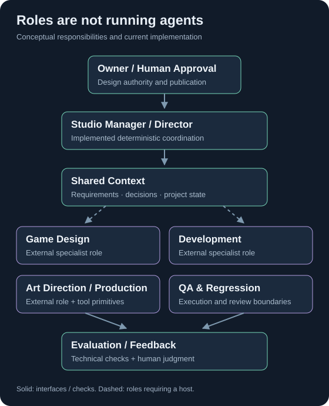
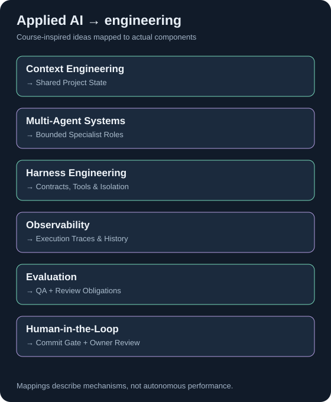
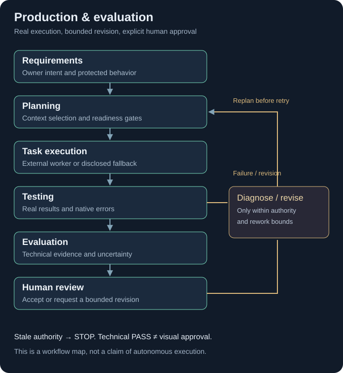

# GameFactory Agents

### From game-development intent to inspectable, playable results.

**Burak Yenice** · **GameFactory V2** · Applied AI at **DTU** · Proprietary framework

[Architecture](docs/architecture.md) · [Applied AI case study](docs/applied-ai-case-study.md) · [Three real iterations](examples/little-star-jump/README.md) · [Play the demo](examples/little-star-jump/SOURCE.md)

## What is GameFactory?

GameFactory is an experimental framework for AI-assisted game development. It organizes requirements, bounded tasks, source changes, tests and review around shared project context—so an iteration can be traced from the owner's request to a working result.

This repository is a product showcase, technical portfolio and Applied AI case study. The framework core is proprietary and excluded. Commercial licensing is not yet generally available. [Copyright and scope](COPYRIGHT.md).

## Multi-Agent Architecture

The Director selects context and routes specialist responsibilities. Game Design, Development, Art and QA are distinct roles; their contracts are implemented, while execution requires an external host. **The Director is deterministic orchestration, not an LLM.** The demonstration below used one external Codex operator, with same-agent review—not an independent agent swarm.

[View full-size diagram](assets/architecture.svg) · [Architecture and execution boundaries](docs/architecture.md)

## Core Capabilities

| Capability | Evidence and status |
| --- | --- |
| Structured context and bounded planning | **Verified locally:** CLI, schema validation and deterministic Director records. |
| Guarded source changes | **Verified in the demo:** scoped tasks, hashed changesets, apply and source-freshness checks. |
| Godot QA and iteration | **Verified in this game:** real scene tests and three playable Windows releases. |
| Evidence and review | **Verified boundaries:** retained outcomes, failed attempts and explicit review authority. |
| Native art tools | **Limited verified primitive:** editable Pixelorama round trips; artistic quality still needs review. |
| General multi-agent production and art planning | **Experimental:** contracts and external integration, not proven unattended production. |
| Autonomous quality judgment or self-improvement | **Unsupported:** no general evaluator, optimizer or native model-provider host is claimed. |

[Capability detail](docs/capabilities.md) · [Verification scope](docs/verification.md)

## Applied AI at DTU

Developed in connection with Applied AI studies at the Technical University of Denmark. This independent student project translates course concepts into inspectable engineering mechanisms:

- **Context engineering:** scoped requirements, decisions and relevant project state.
- **Harness engineering:** task contracts, tool boundaries, isolation, validation and recovery.
- **Architecture and evaluation:** specialist responsibilities, observable execution, regression checks and human authority.

[View full-size diagram](assets/applied-ai-map.svg) · [Read the existing technical case study](docs/applied-ai-case-study.md), including the earlier Fleet prototype, evaluation dimensions and lessons learned. The private coursework submission is not reproduced; no DTU endorsement is implied.

## Technical Limitations and Lessons Learned

Role definitions are not proof of agent execution. Fixture tests are not live-tool proof. Technical PASS is not artistic acceptance. The discontinued Star Greenhouse 2 experiment made that last distinction concrete.

GameFactory coordinates context, tasks, guarded application and evidence. **Codex supplied the implementation, operated tools, reviewed its own work and packaged releases.** General autonomy and subjective quality remain unproven. The retained framework checks cover named lanes; no new full framework regression was run for this presentation.

[View full-size diagram](assets/production-loop.svg) · [Limits and lessons](docs/applied-ai-case-study.md#9-star-greenhouse-2-limitations-and-lessons) · [Restrained future directions](docs/roadmap.md)

## GameFactory in Action

### One Game. Three Prompts. Three Iterations.

*From a simple request to a playable game, then incremental improvements without repeating the original requirements.*

### 01 — Create

**Exact opening line** — [full original request](examples/little-star-jump/README.md#iteration-01--create).

> Improve Little Star Jump into a small but polished, complete-feeling 2D pixel-art platformer.

*v0.2.0 · Recorded from the preserved Windows release.*

A working prototype became a polished miniature platformer: animated pixel scenery, responsive controls, sound, title/pause/victory screens and replay. **29 gameplay checks + 34 rendered checks passed.**

[Iteration 01 evidence and playable output](examples/little-star-jump/README.md#iteration-01--create)

### 02 — Improve

> The jumping feels too floaty. Make it snappier and more responsive.

*v0.2.1 · Tap for a hop; hold for height.*

Stronger gravity and faster falls cut held-jump airtime by **25%: 0.867 → 0.650 seconds**, with almost the same height. The three-star route, coyote time and input buffer stayed intact. **32 gameplay + 37 rendered checks passed.**

[Before/after clips, changed files and evidence](examples/little-star-jump/README.md#iteration-02--improve)

### 03 — Extend

> Add a moving platform that I can jump onto.

*v0.2.2 · Jump aboard; the platform carries the player automatically.*

A moving mossy platform added an optional route to the middle ledge. Boarding, riding through a turnaround, jumping off, pause/restart and the original route were checked. **41 gameplay + 47 rendered checks passed.**

[Iteration 03 evidence and regression checks](examples/little-star-jump/README.md#iteration-03--extend)

**Prompt 1 → Playable Game · Prompt 2 → Improved Jumping · Prompt 3 → Moving Platform**

[Play or inspect all three releases](examples/little-star-jump/SOURCE.md) · [Exact prompts and execution trail](examples/little-star-jump/README.md) · [Media provenance and still-image fallbacks](examples/little-star-jump/MEDIA.md)
