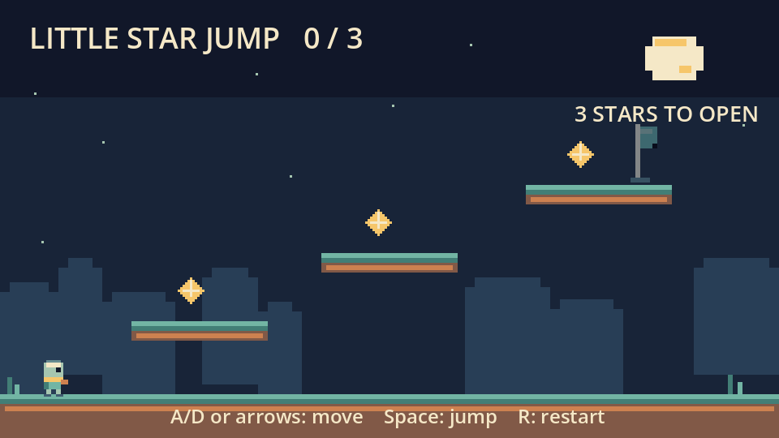
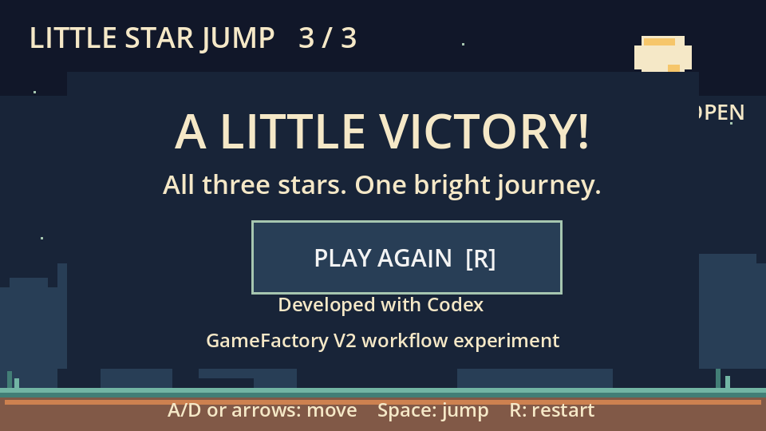

# Little Star Jump — a working game, an explicit workflow boundary

One 320×180 screen. Three ascending platforms. Three collectible stars. A locked flag goal, victory screen and restart. Twelve-color original raster art; no layered Pixelorama claim.

## Actual participation

| Step | What actually happened |
| --- | --- |
| Requirements | The owner specified the tiny game and allowed a disclosed direct-execution fallback. |
| Director | The existing CLI initialized a project, produced a NEW plan and selected specialist routes. |
| External design task | A real task was exported and a bounded Codex planning result was ingested. No independent model worker was launched. |
| Authority boundary | The result remained NEEDS_USER_DECISION because canonical foundation approval was absent. The initial legacy-source request and one malformed result were rejected and retained, then corrected through supported contracts. |
| Development and art | Codex implemented the separate demo directly and drew original integer-grid PNG assets using code. This was outside GameFactory production/apply. |
| Native QA | Godot imported and ran the real scene. 21 headless gameplay checks passed; the rendered route passed 22 checks including the earned win capture. |
| Human review | Publication and subjective owner playtesting remain pending. |

The win attribution is **Developed with Codex — GameFactory V2 workflow experiment**. No GameFactory ChangeSet, canonical QA PASS, automated visual approval, independent QA agent or fully autonomous game production is claimed.

## Verification limits

Tested on Windows with Godot 4.7.2 and the compatibility renderer. The positive route used actual movement and jump inputs to collect all stars, then entered the goal. The negative goal test placed the player in the real goal Area with zero stars. Restart was exercised through the actual button callback and R-key event.

The first test runner had a scene-loading synchronization error; its failed result was retained. The corrected real-scene checks passed. No full GameFactory regression was run for this demonstration. Other platforms, owner playtesting and an exported standalone binary are not claimed.

The independently staged repository is **gamefactory-demo-platformer**. Its source project and launch instructions are ready for review; no public repository/download link is invented. Demo licensing is a separate owner decision from the proprietary framework license.
