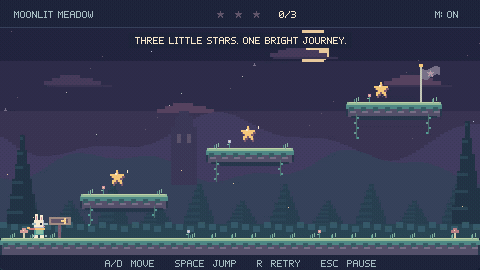
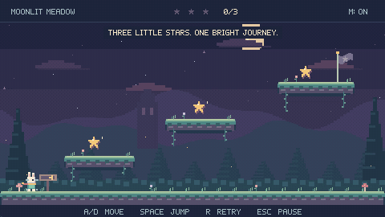
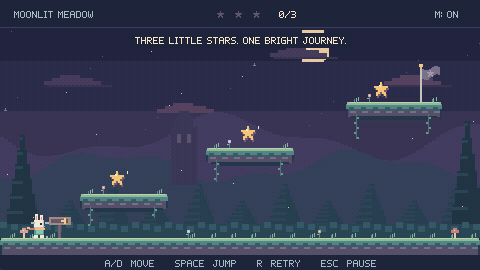
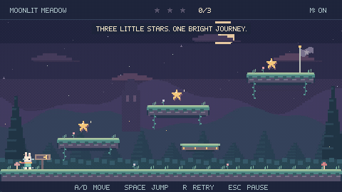

# One Game. Three Prompts. Three Iterations.

[← GameFactory Agents](../../README.md) · [Source and playable releases](SOURCE.md) · [Media provenance](MEDIA.md)

Little Star Jump is a one-screen Godot platformer: three stars unlock a flag, then the player can replay. These three real requests produced v0.2.0, v0.2.1 and v0.2.2. Each follow-up kept the existing game context instead of repeating the original requirements.

The earlier prototype is preserved separately. The first showcased request explicitly asks to **improve** that prototype; it is not presented as a blank-slate creation prompt.

| Stage | Native scene checks | Rendered checks | Result |
| --- | --- | --- | --- |
| 01 · v0.2.0 | 29/29 | 34/34 | Polished playable game |
| 02 · v0.2.1 | 32/32 | 37/37 | 25% shorter jump airtime |
| 03 · v0.2.2 | 41/41 | 47/47 | Rideable moving platform |

## What GameFactory actually did

GameFactory's deterministic CLI selected context, planned bounded tasks, exported external work, validated submitted changesets, applied source changes, ran native QA, tracked evidence and enforced review/handoff boundaries. One external Codex operator authored the code, operated the tools, supplied same-agent review and packaged/published the demo. There was no independent multi-agent execution or autonomous visual acceptance.

This presentation reuses those completed records. It does not rerun production, add mechanics or invoke a new Director plan. Only demonstration recording and documentation checks were performed for the showcase.

## Iteration 01 — Create

### Exact user prompt

> Improve Little Star Jump into a small but polished, complete-feeling 2D pixel-art platformer.
> Keep the gameplay simple. Focus on visual quality, responsive controls, animations, and overall polish.
> Use GameFactory V2's existing production workflow to plan, implement, evaluate, and deliver the playable game autonomously.
> Preserve the previous working version. Include the original request, actual workflow evidence, and final game output in the GitHub demo case study.

[Verbatim text](prompts/01.txt). This is the actual request retained in the execution record, not a rewritten historical quotation. The README quotes only its exact first sentence. “Create” names the first showcased polished output; a working prototype already existed.

### Result and implementation

The polished release evolved from the preserved prototype. It added original procedural pixel art, character/world animation, sound, forgiving controls and the full title → play → pause → victory → replay flow. Its final production pass also corrected headless audio allocation and toast readability.

**Changed files:** `project.godot`; `scripts/main.gd`, `player.gd`, `pixel.gd`, `world.gd`, `sound.gd`; `tests/gameplay_test.gd`, `capture.gd` across the polish passes.

**Verified then:** 29/29 native scene checks and 34/34 rendered checks. The Windows executable was also played through the real flow. These are historical release results, not freshly rerun production or a new framework regression.

**Preserved result:** [v0.2.0 source](https://github.com/burakync/gamefactory-demo-platformer/tree/v0.2.0) · [commit bbf0d01](https://github.com/burakync/gamefactory-demo-platformer/commit/bbf0d01396d831b1bf6bb8223057b733f639c820) · [Windows download](https://github.com/burakync/gamefactory-demo-platformer/releases/tag/v0.2.0) · [verification snapshot](evidence/v0.2.0-verification.json).

Prompt → processing → execution → changes → QA → output

- **Processing:** [Director plan](https://github.com/burakync/gamefactory-demo-platformer/blob/v0.2.0/docs/evidence/director-plan.json) binds the request to scoped work.
- **Execution and changed files:** [guarded production apply](https://github.com/burakync/gamefactory-demo-platformer/blob/v0.2.0/docs/evidence/production-apply.json); external Codex supplied the code.
- **QA:** [actual run](https://github.com/burakync/gamefactory-demo-platformer/blob/v0.2.0/docs/evidence/qa-run.json) → native run <code>TRUN-9cf20335-4b84-4f5d-a819-268d14ef9584</code> → evidence <code>EVID-0014</code>.
- **Review:** [same-agent result ingestion](https://github.com/burakync/gamefactory-demo-platformer/blob/v0.2.0/docs/evidence/review-ingest.json); no independent model worker was launched.
- **Handoff:** [HANDOFF-d79bb4c5-5093-a85a-3067-92fbea7b3050](https://github.com/burakync/gamefactory-demo-platformer/blob/v0.2.0/docs/evidence/handoff-create.json) recorded a verified bounded change at that release. Historical freshness must not be read as current-source acceptance after later iterations.
- **Output:** versioned source and Windows release above; GIFs were recorded later from the same preserved executable hashes.

## Iteration 02 — Improve

### Exact user prompt

> The jumping feels too floaty. Make it snappier and more responsive.

[Verbatim text](prompts/02.txt). This is the actual request retained in the execution record, not a rewritten historical quotation.

### Result and implementation

The controller changed ascent gravity from 670 to 1000 px/s², descent gravity to 1500 px/s², launch speed from 285 to 350 px/s and release cutoff from 115 to 100 px/s. Measured airtime fell from 0.867 to 0.650 s; height stayed near 64 pixels. Tests retained the original route, coyote time and buffering.

**Changed files:** `scripts/player.gd`, `tests/gameplay_test.gd`, `project.godot`.

| Before — v0.2.0 | After — v0.2.1 |
| --- | --- |
|  |  |

Both recordings use the same tap-then-held-jump input sequence. These are live recordings, not frame-synchronized laboratory captures. The quantitative timing comes from the retained 60 Hz scene tests.

**Verified then:** 32/32 native scene checks and 37/37 rendered checks. The Windows executable was also played through the real flow. These are historical release results, not freshly rerun production or a new framework regression.

**Preserved result:** [v0.2.1 source](https://github.com/burakync/gamefactory-demo-platformer/tree/v0.2.1) · [commit c929012](https://github.com/burakync/gamefactory-demo-platformer/commit/c9290128fbd6444b36d3def35e2cdf735007b060) · [Windows download](https://github.com/burakync/gamefactory-demo-platformer/releases/tag/v0.2.1) · [verification snapshot](evidence/v0.2.1-verification.json).

Prompt → processing → execution → changes → QA → output

- **Processing:** [Director plan](https://github.com/burakync/gamefactory-demo-platformer/blob/v0.2.1/docs/evidence/snap-director-plan.json) binds the request to scoped work.
- **Execution and changed files:** [guarded production apply](https://github.com/burakync/gamefactory-demo-platformer/blob/v0.2.1/docs/evidence/snap-production-apply.json); external Codex supplied the code.
- **QA:** [actual run](https://github.com/burakync/gamefactory-demo-platformer/blob/v0.2.1/docs/evidence/snap-qa-run.json) → native run <code>TRUN-34c2e5b7-328f-4671-9aa2-cda19794d5c9</code> → evidence <code>EVID-0015</code>.
- **Review:** [same-agent result ingestion](https://github.com/burakync/gamefactory-demo-platformer/blob/v0.2.1/docs/evidence/snap-review-ingest.json); no independent model worker was launched.
- **Handoff:** [HANDOFF-0f3c8fe8-102f-d04f-c9bc-8b2acf6e0da8](https://github.com/burakync/gamefactory-demo-platformer/blob/v0.2.1/docs/evidence/snap-handoff-create.json) recorded a verified bounded change at that release. Historical freshness must not be read as current-source acceptance after later iterations.
- **Output:** versioned source and Windows release above; GIFs were recorded later from the same preserved executable hashes.

## Iteration 03 — Extend

### Exact user prompt

> Add a moving platform that I can jump onto.

[Verbatim text](prompts/03.txt). This is the actual request retained in the execution record, not a rewritten historical quotation.

### Result and implementation

A new AnimatableBody2D supplies one-way landing, smooth lateral travel and automatic rider carry. The main scene starts, pauses, stops and resets it. A queued star overlap discovered after restarting from the middle ledge is now rejected using actual collision bounds. The existing player controller is unchanged.

**Changed files:** `scripts/moving_platform.gd`, `scripts/main.gd`, `tests/gameplay_test.gd`, `project.godot`; generated Godot UID metadata in the delivery checkout.

**Verified then:** 41/41 native scene checks and 47/47 rendered checks. The Windows executable was also played through the real flow. These are historical release results, not freshly rerun production or a new framework regression.

**Preserved result:** [v0.2.2 source](https://github.com/burakync/gamefactory-demo-platformer/tree/v0.2.2) · [commit 60c873b](https://github.com/burakync/gamefactory-demo-platformer/commit/60c873b82ff07dc2df2e2f1d7292ea92143705fb) · [Windows download](https://github.com/burakync/gamefactory-demo-platformer/releases/tag/v0.2.2) · [verification snapshot](evidence/v0.2.2-verification.json).

Prompt → processing → execution → changes → QA → output

- **Processing:** [Director plan](https://github.com/burakync/gamefactory-demo-platformer/blob/v0.2.2/docs/evidence/platform-director-plan.json) binds the request to scoped work.
- **Execution and changed files:** [guarded production apply](https://github.com/burakync/gamefactory-demo-platformer/blob/v0.2.2/docs/evidence/platform-production-apply.json); external Codex supplied the code.
- **QA:** [actual run](https://github.com/burakync/gamefactory-demo-platformer/blob/v0.2.2/docs/evidence/platform-qa-run.json) → native run <code>TRUN-683ceecf-4d48-40db-b529-b780577a831c</code> → evidence <code>EVID-0016</code>.
- **Review:** [same-agent result ingestion](https://github.com/burakync/gamefactory-demo-platformer/blob/v0.2.2/docs/evidence/platform-review-ingest.json); no independent model worker was launched.
- **Handoff:** [HANDOFF-f6717127-ccd4-7391-8ebb-801f4ecb18a0](https://github.com/burakync/gamefactory-demo-platformer/blob/v0.2.2/docs/evidence/platform-handoff-create.json) recorded a verified bounded change at that release. Historical freshness must not be read as current-source acceptance after later iterations.
- **Output:** versioned source and Windows release above; GIFs were recorded later from the same preserved executable hashes.

## Limits and retained failures

Passing assertions cover their declared scene flows. Owner enjoyment, artistic approval, subjective audio listening, other operating systems and gamepad/touch were not certified. The Windows executables are unsigned. Framework-wide regression was not rerun for this presentation.

Failed capture/test attempts remain identified in the demo case studies. The polish work corrected audio cleanup and input-test timing; the jump update first showed the old controller failing the new timing thresholds; the moving-platform update exposed the queued star event after restart. See [original production case](https://github.com/burakync/gamefactory-demo-platformer/blob/v0.2.0/docs/CASE_STUDY.md), [jump tuning](https://github.com/burakync/gamefactory-demo-platformer/blob/v0.2.1/docs/JUMP_TUNING.md) and [moving platform](https://github.com/burakync/gamefactory-demo-platformer/blob/v0.2.2/docs/MOVING_PLATFORM.md).

[Machine-readable prompt/release/evidence index](evidence/iterations.json). Public demo receipts already redact local paths; the proprietary framework source and private coursework stay excluded.
